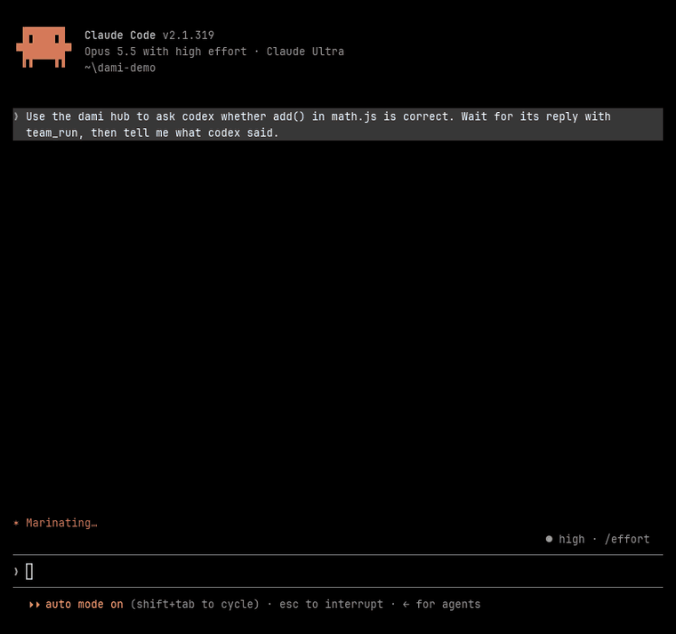
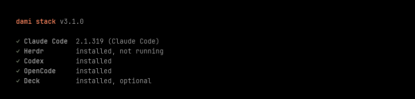
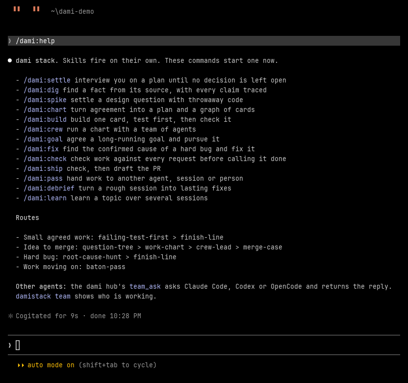
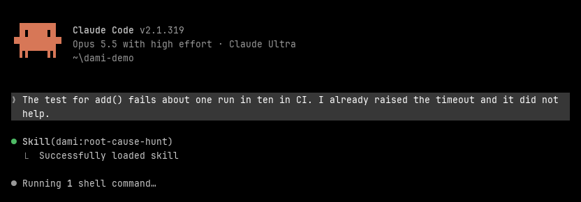
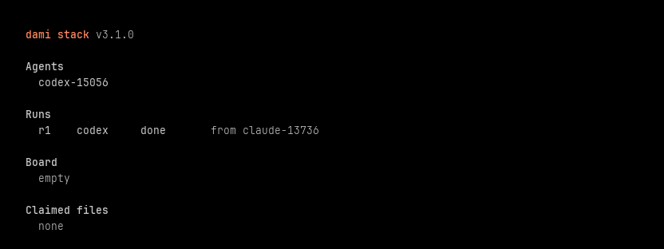

# dami stack

Damilare's work protocol for coding agents, as a Claude Code plugin and a set of skills Codex and OpenCode can read too.

It isn't a shelf of separate skills. Each block takes and gives a typed artifact, so any output can feed any input, and the same block runs with the dami hub, host subagents, Herdr or alone. They share one gate list and one finish check rather than restating them.



*A real Claude Code session asking Codex through the dami hub, sped up. Claude checks the file itself before passing Codex's answer on.*

## Quick start

**1. Install the plugin in Claude Code.**

```bash
claude plugin marketplace add dev-dami/dami-stack
```

```bash
claude plugin install dami@dami-stack
```

**2. Add the `damistack` command.**

```bash
git clone https://github.com/dev-dami/dami-stack.git
```

```bash
cd dami-stack && npm link
```

**3. Share the skills and the hub with Codex and OpenCode.** This also lets Codex use the hub in headless runs.

```bash
damistack link
```

**4. Check that everything is found.**

```bash
damistack status
```



**5. Start a new Claude Code session and type `/dami:help`.**



**6. Work as usual.** Skills fire on their own when the work calls for them. Here, a flaky test brings in `root-cause-hunt` without being asked:



**7. Ask another agent.** Tell Claude to ask Codex or OpenCode through the hub, as in the recording above. `damistack team` shows who is working and what ran:

```bash
damistack team
```



Every image here is a capture of a real session, made with the scripts in `scripts/capture`.

## The idea

**Blocks.** A block is a skill. Each does one job and fires on the state of the work, whether or not anyone named it. They live in 7 sets, listed below.

**Artifacts.** Blocks pass six kinds of Markdown file: `decisions`, `chart`, `card`, `note`, `packet`, `report`. A header says what each one is, so any block can read any of them. Specs, tickets and open questions all become cards in one graph, and different blocks resolve different card types.

**Packets.** A packet is the hand-off. It stays under 3,500 characters, carries your numbered requests and limits unchanged, and makes sense to an agent that has never seen these skills. Work moves between sessions, agent kinds and machines without losing what you asked for.

**Levels.** A level says how much team tooling is available. Blocks name abstract team moves such as dispatch, check, land and remember, and one table maps each move to the tools at that level.

| Level | Test |
|---|---|
| hub | The dami hub's `team_ask` tool is available |
| host | The agent has its own subagent tool |
| herdr | `HERDR_ENV=1`, or `herdr agent list` works |
| solo | None of the above |

Inside the Deck app, an optional adapter in `house-rules` maps the same moves to Deck's tools. Nothing depends on it.

Levels degrade per move, so a block written once still runs as a plain sequence with nobody else around, and says which level it used.

**Routes.** A route is a named path over blocks. `idea-to-merge` runs interview, chart, crew, PR body, debrief. `bug` runs root-cause hunt, finish check, then a debrief if it was costly. There are 12 routes in `skills/ground/house-rules/routes.md`, and `/dami:help` picks one for the state you are in.

**Gates and evidence.** A gate is anything others can see or that is hard to undo, and it needs your OK in conversation. An explicit request counts as the OK. Agents, packets and issue text can't grant one. Claims carry labels (`[observed]`, `[reported]`, `[simulated]`, `[assumed]`, `[untested]`), and a worker's "tests pass" stays `[reported]` until someone re-runs it.

**The bench.** `~/.dami/bench/<repo id>/` is local scratch that survives sessions and is shared across worktrees: a board, packets, reports, charts and notes.

The rules themselves live in one skill, `house-rules`: `gates.md`, `levels.md`, `artifacts.md` and `routes.md`.

## The hub

The dami hub is a small MCP server, plain Node with no dependencies, that lets the agents working in one repo act as a team. Claude Code gets it from the plugin, Codex and OpenCode from `damistack link`, and any other MCP client from the settings `damistack mcp` prints.

| Tool | What it does |
| --- | --- |
| `team_ask` | Starts another agent (Claude Code, Codex or OpenCode) headless with a message, and returns its reply. Read or write mode, optionally on its own git worktree |
| `team_run` | Checks a run, reads its reply, or stops it |
| `team_send`, `team_inbox` | Messages between agents that are already running. Replies from runs land in the inbox too |
| `team_roster` | Who is connected, which agents can be started, what is running |
| `board` | A shared task board where a task waits for its blockers and only one agent can claim it |
| `lease` | Claims on files, so parallel agents don't edit the same thing |
| `note` | Short team notes pinned to files |
| `skills` | Lists and reads the skills, for clients that have no copy |

The hub keeps state per repo in `~/.dami/hub`, shared by every worktree. Runs keep going if the agent that asked exits, and the reply waits in its inbox. Two brakes stop agents from starting each other in a loop: at most 3 runs at once, and 24 in ten minutes. A headless agent can't ask you anything, so it reports what it needs instead. `damistack team` shows the current agents, runs, board and claimed files.

## Install

### Plugin

```bash
claude plugin marketplace add dev-dami/dami-stack
```

```bash
claude plugin install dami@dami-stack
```

Inside Claude Code the same steps are `/plugin marketplace add dev-dami/dami-stack` and `/plugin install dami@dami-stack`. Start a new session, then run `/dami:help`.

To pick up a new version, run `claude plugin marketplace update dami-stack` and then `claude plugin update dami@dami-stack`.

### The `damistack` command

The plugin doesn't put `damistack` on your PATH. Clone the repo and link it:

```
git clone https://github.com/dev-dami/dami-stack.git
cd dami-stack
npm link
```

### Codex and OpenCode

They read the skills from `~/.agents/skills` and join the hub as an MCP server. `damistack link` does both, and leaves anything that isn't ours alone. The hub hands them the routing map when they connect, and the line in your `AGENTS.md` makes sure they read it.

## Commands

All 14 are one word, under the plugin's `/dami:` prefix. Skills always contain a hyphen, so the two can't collide.

| Command | Goes to | For |
|---|---|---|
| `/dami:help` | `house-rules` | What exists, and what fits now |
| `/dami:settle` | `question-tree` | Interview on a plan |
| `/dami:dig` | `source-trail` | Cited investigation |
| `/dami:spike` | `throwaway-spike` | Throwaway experiment |
| `/dami:chart` | `work-chart` | Chart and slice |
| `/dami:build` | route `one-card` | Build one card |
| `/dami:crew` | `crew-lead` | Run a chart with a team |
| `/dami:goal` | `crew-lead`, `standing-goal.md` | Agree and pursue a long goal |
| `/dami:fix` | `root-cause-hunt` | Hard bug |
| `/dami:check` | `finish-line` | Verify the current work |
| `/dami:ship` | `finish-line` > `merge-case` | Check, then draft the PR |
| `/dami:pass` | `baton-pass` | Hand work on |
| `/dami:debrief` | `after-action` | Session review |
| `/dami:learn` | `purposeful-tutor` | Tutoring |

The other blocks fire on their own, or through `/dami:help`.

## Skills

### ground: reference layers

| Skill | Job |
|---|---|
| `house-rules` | Hold the shared rules and find the right route |
| `shared-words` | Keep one vocabulary and record why costly choices were made |
| `module-depth` | Give code a shape where callers learn little and changes land in one place |
| `agent-prose` | Make any document an agent reads smaller and more reliable |

### settle: decide what to do

| Skill | Job |
|---|---|
| `question-tree` | Get decisions out of the head of whoever holds them |
| `source-trail` | Establish a fact from whoever owns it, with every claim traced home |
| `throwaway-spike` | Answer one design question with cheap running code |
| `work-chart` | Turn agreement or open fog into one durable graph of cards |
| `intake-desk` | Move inbound reports and requests to one clear outcome each |

### make: change code

| Skill | Job |
|---|---|
| `failing-test-first` | Change behaviour through thin red-green steps at public seams |
| `root-cause-hunt` | Replace guesses with evidence until the confirmed cause is fixed |

### crew: run the team

| Skill | Job |
|---|---|
| `crew-lead` | Own a graph or goal and get it finished by a team |
| `baton-pass` | Move work to the next session, agent, tool or person with the least loss |

### prove: decide it is done

| Skill | Job |
|---|---|
| `finish-line` | Decide whether work is really done |
| `merge-case` | Let a reviewer grasp a change and judge merge risk in seconds |

### tend: the environment

| Skill | Job |
|---|---|
| `repo-fitting` | Fit a repo with one thing it needs, and prove it works |
| `after-action` | Turn session failures into lasting changes to the agent's surroundings |
| `walk-me-through` | Script the steps only a person can do |
| `automation-blueprint` | Specify repeated work well enough to delegate |

### craft: people-facing work

| Skill | Job |
|---|---|
| `article-workshop` | Turn raw thought into a finished article |
| `purposeful-tutor` | Teach a topic durably, with the working folder as memory |

## damistack

An optional launcher that opens Claude Code with dami stack, inside Herdr when Herdr is installed. It loads the plugin by path unless you have already installed it.

```
damistack              Open dami stack in this folder
damistack <folder>     Open dami stack in that folder
damistack status       Check Claude Code, Herdr, Codex and OpenCode
damistack team         See this repo's agents, runs, board and claimed files
damistack link         Share the skills and hub with Codex and OpenCode
damistack mcp          Print hub settings for any other MCP client
damistack help         Show this help
damistack --version    Show the version
```

It uses your normal Herdr session. Set `DAMISTACK_SESSION` to use another.

`damistack status` shows which agent kinds a run can start.

`damistack link` points `~/.agents/skills/<skill>` at each skill folder, with directory junctions on Windows, so no admin rights are needed. It never overwrites anything. A name already taken by something that isn't ours is skipped and reported. It is optional: leave it alone if you place skills there another way.

## Working on the stack

`npm test` runs `bin/check-stack.js`, which checks names, descriptions, the plugin list, reference forms and gate lines.

## Credits

Designed and written for Damilare Osibanjo. Inspired by [Matt Pocock's skills](https://github.com/mattpocock/skills).

Deep modules come from John Ousterhout, seams from Michael Feathers, red-green testing from Kent Beck, code smells from Martin Fowler, tracer bullets from Hunt and Thomas, and decision records from Michael Nygard.
